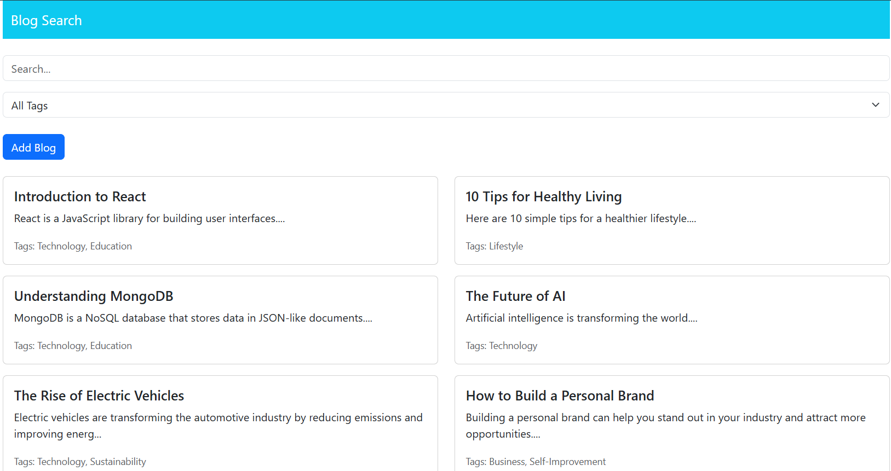
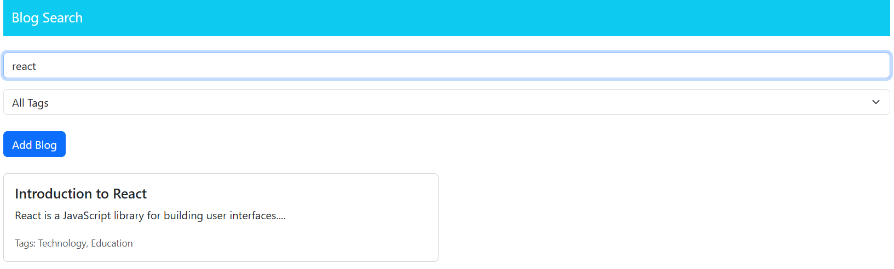
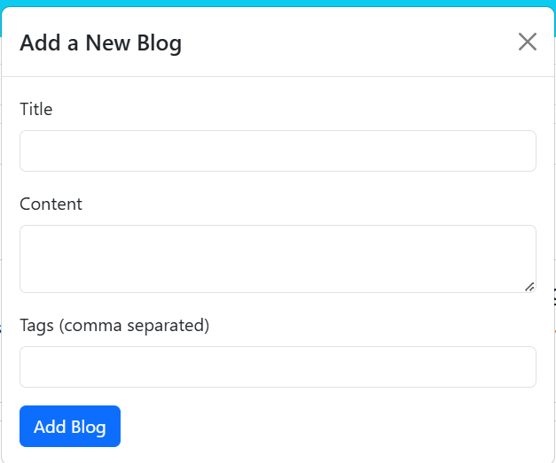
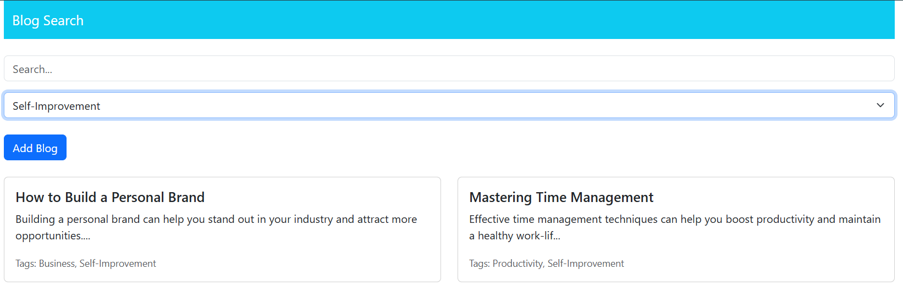
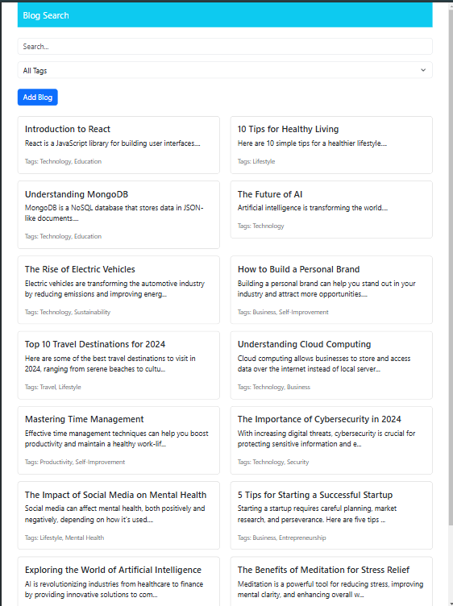

# BlogSite 📝

A simple blogging app built on the **MERN stack** (MongoDB, Express, React, Node.js). Browse blog posts, search them by keyword, filter them by tag and publish new posts from a modal form.


---

## 🚀 Features

- Browse all blog posts as cards showing title, content and tags.
- Keyword search across blog titles and content (case-insensitive).
- Filter posts by tag from a drop-down.
- Add a new blog post (title, content, comma-separated tags) through a modal form.
- Responsive Bootstrap layout that works on mobile.

---

## 📸 Screenshots

### Home Page


### Search Blog


### Add a New Blog


### Filter Blogs by Tags


### Mobile-Friendly Design


---

## 🛠 Tech Stack

| Layer    | Tech                                      |
|----------|-------------------------------------------|
| Frontend | React 19 (Create React App), Axios, Bootstrap 5 |
| Backend  | Node.js, Express, Mongoose, CORS, dotenv  |
| Database | MongoDB                                   |

---

## 💻 Getting Started

### Prerequisites

- Node.js and npm
- MongoDB running locally, or a connection string to a remote MongoDB server

### Steps

1. Clone the repository:

   ```bash
   git clone https://github.com/sharky412/BlogsSite.git
   cd BlogsSite
   ```

2. Install backend dependencies:

   ```bash
   cd backend
   npm install
   ```

3. Configure the backend. Create (or edit) `backend/.env`:

   ```env
   MONGO_URI=your_mongodb_connection_string
   PORT=5000
   ```

   Sample posts you can import into your database are in `backend/mongoDB.json`.

4. Start the backend (runs on http://localhost:5000):

   ```bash
   npm run dev     # with nodemon
   # or
   npm start
   ```

5. In a second terminal, install and start the frontend:

   ```bash
   cd frontend
   npm install
   npm start
   ```

6. Open http://localhost:3000 in your browser.

---

## 📡 API

| Method | Endpoint      | Description                                                        |
|--------|---------------|--------------------------------------------------------------------|
| GET    | `/`           | List blogs. Optional query params: `query` (text search), `tag`.   |
| POST   | `/api/blogs`  | Create a blog. Body: `{ title, content, tags }` (tags comma-separated). |

---

## 📁 Project Structure

```
BlogsSite/
├── backend/
│   ├── models/Blog.js         # Mongoose schema (title, content, tags)
│   ├── routes/BlogRoutes.js   # API routes
│   ├── mongoDB.json           # Sample blog data
│   └── server.js              # Express server
├── frontend/
│   └── src/
│       ├── App.js             # Main page + "Add Blog" modal
│       └── components/        # Navbar, SearchBox, BlogCard
└── images/                    # Screenshots
```

---

## 🤝 Contributions

Contributions are welcome! Feel free to fork the repository and submit pull requests.
